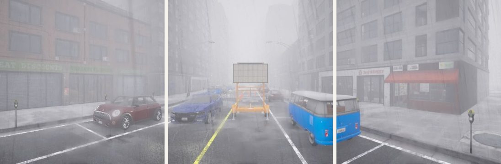

<div align="center">


</div>

<h1 align="center">CARLA Dataset</h1>



### Overview

LEAD's privileged expert drives 43 scenario types across 12 CARLA towns. Each log has six cameras at 4 Hz and a top lidar and radar at 20 Hz. The labels are 3D boxes, traffic light states, the ego state, the route, and per-camera depth, semantic and instance segmentation. The perturbed view repeats the routes with the camera rig rotated and translated, so that a policy can learn to recover from drift.

| View               |  Logs | Hours | Used for training |
| :----------------- | ----: | ----: | :---------------- |
| `normal_view`      | 8,800 |   ~85 | Yes               |
| `perturbated_view` | 8,800 |   ~85 | No                |

We train on the normal view only. The perturbed view is a simulator-only augmentation with no counterpart in the real datasets, so leaving it out keeps the CARLA training data comparable to nuPlan and Physical AI AV.

### Download data

CARLA logs are collected with [LEAD](https://github.com/kesai-labs/lead) and hosted in 123D format on Hugging Face as [ln2697/lead-123d](https://huggingface.co/datasets/ln2697/lead-123d). The normal view and the maps are enough:

```bash
hf download ln2697/lead-123d --repo-type dataset --local-dir $PY123D_GARAGE_DATA_ROOT/lead/123D \
    --include 'logs/normal_view/*' 'maps/*' 'config.yaml'
```

Drop `--include` to also fetch the perturbed camera views.

### Collect yourself

There is no conversion step: LEAD's privileged expert drives the Leaderboard 2.0 routes and writes 123D directly, at the 20 Hz tick rate for point clouds and scene state and every fifth tick for the cameras. See the LEAD repository for the data collection scripts.

### Expected layout

```
$PY123D_GARAGE_DATA_ROOT/lead/123D/
├── config.yaml
├── logs/
│   └── normal_view/
│       ├── Accident/
│       │   └── Town03_Rep0_route_001783_route0_08_02_07_21_33/
│       │       ├── box_detections_se3.arrow
│       │       ├── camera.pcam_{f0,b0,l0,l1,r0,r1}.arrow
│       │       ├── camera_depth.pcam_{f0,b0,l0,l1,r0,r1}.arrow
│       │       ├── camera_instance.pcam_{f0,b0,l0,l1,r0,r1}.arrow
│       │       ├── camera_semantic.pcam_{f0,b0,l0,l1,r0,r1}.arrow
│       │       ├── custom.driving_meta.arrow
│       │       ├── ego_state_se3.arrow
│       │       ├── lidar.lidar_top.arrow
│       │       ├── radar.radar_merged.arrow
│       │       ├── sync.arrow
│       │       └── traffic_light_detections.arrow
│       └── ... (43 scenario types)
└── maps/
    └── carla/
        ├── carla_town01.arrow
        └── ... (Town01 through Town15)
```
