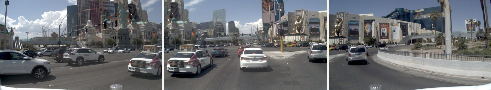

<div align="center">


</div>

<h1 align="center">nuPlan Dataset</h1>



### Overview

nuPlan holds about 1,280 hours of driving in Las Vegas, Boston, Pittsburgh and Singapore, at 10 Hz. Only 1,457 of its 15,910 logs carry sensor data, eight cameras and a merged lidar; the training recipe uses the three front cameras. The logs carry auto-labeled 3D boxes, traffic light states and the route, and each city comes with an HD map.

| Split          |   Logs | Logs with sensors | Camera hours | Used for training               |
| :------------- | -----: | ----------------: | -----------: | :------------------------------ |
| `nuplan_train` | 13,180 |             1,085 |         ~110 | Yes                             |
| `nuplan_val`   |  1,381 |               225 |          ~14 | Yes                             |
| `nuplan_test`  |  1,349 |               147 |          ~11 | No: held out for NAVSIM navtest |

Camera hours are estimated from a sample of logs.

### Download data in 123D format

nuPlan v1.1 is hosted in 123D format on Hugging Face as [kesai-labs/nuplan](https://huggingface.co/datasets/kesai-labs/nuplan). The training recipe needs the sensor logs, the three front cameras, the metadata and the maps. The command below also keeps the lidar, for LiDAR policies:

```bash
hf download kesai-labs/nuplan --repo-type dataset --local-dir $PY123D_GARAGE_DATA_ROOT/nuplan/123D \
    --include 'logs/*' 'maps/*' \
    --exclude '*/camera.pcam_b0.arrow' '*/camera.pcam_l1.arrow' '*/camera.pcam_l2.arrow' \
              '*/camera.pcam_r1.arrow' '*/camera.pcam_r2.arrow'
```

Drop `--exclude` to also fetch the five other cameras. The sensorless logs under `logs_sensorless/` carry no camera or lidar, so no policy here can train on them.

### Convert to 123D yourself

Alternatively, download the raw data from [nuplan.org](https://www.nuplan.org/download) and convert it yourself. See documentation of [py123d](https://kesai.eu/py123d/datasets/nuplan/#conversion).

Our copy embeds the cameras as JPEG and the lidar as laz, instead of the converter's default paths into the raw tree. `route_position` needs py123d >= 0.7.0.

### Expected layout

```
$PY123D_GARAGE_DATA_ROOT/nuplan/123D/
├── logs/
│   ├── nuplan_train/
│   │   └── 2021.05.12.19.36.12_veh-35_00005_00204/
│   │       ├── box_detections_se3.arrow
│   │       ├── camera.pcam_f0.arrow
│   │       ├── camera.pcam_l0.arrow
│   │       ├── camera.pcam_r0.arrow
│   │       ├── custom.scenario.arrow
│   │       ├── ego_state_se3.arrow
│   │       ├── lidar.lidar_merged.arrow
│   │       ├── route_position.arrow
│   │       ├── sync.arrow
│   │       └── traffic_light_detections.arrow
│   ├── nuplan_val/
│   └── nuplan_test/
└── maps/
    └── nuplan/
        ├── nuplan_sg-one-north.arrow
        ├── nuplan_us-ma-boston.arrow
        ├── nuplan_us-nv-las-vegas-strip.arrow
        └── nuplan_us-pa-pittsburgh-hazelwood.arrow
```
