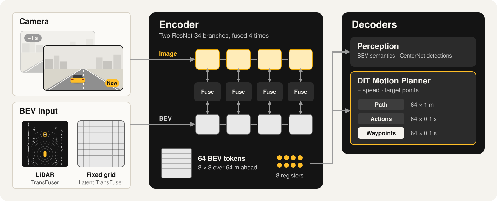
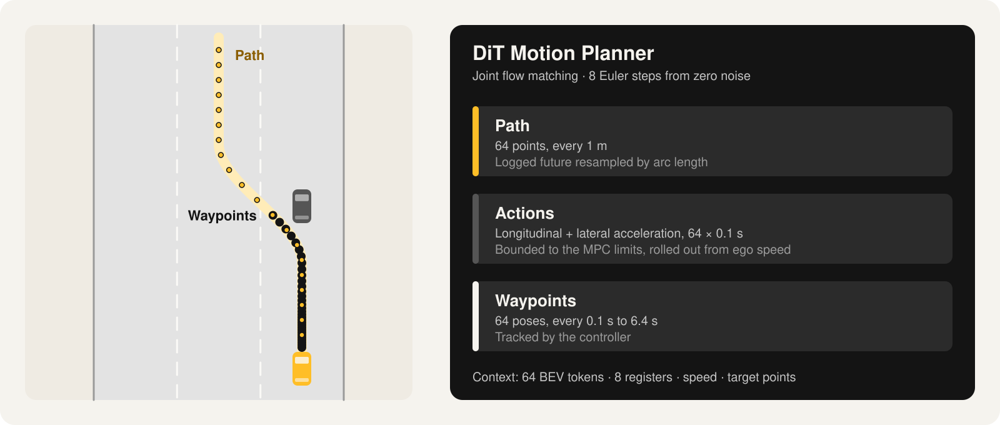
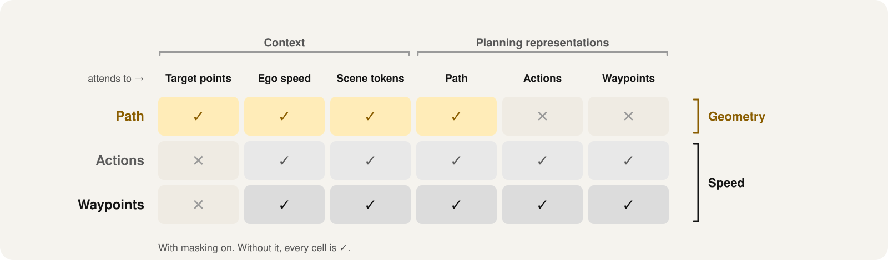
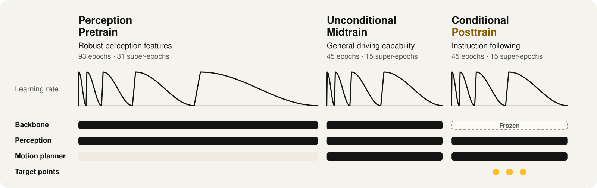
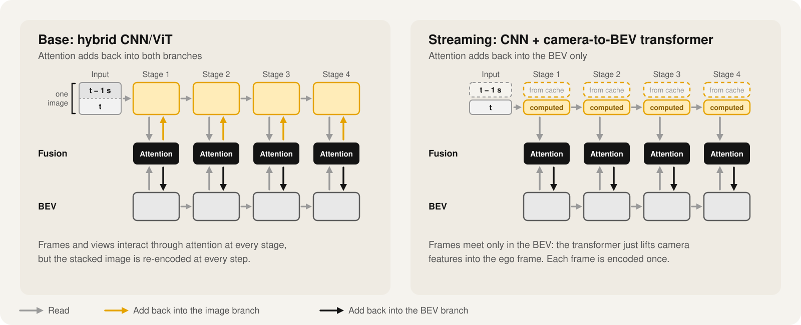

<div align="center">


</div>

<h1 align="center">TransFuser</h1>

TransFuser fuses a camera branch and a bird's-eye-view (BEV) branch with transformers at four resolutions. We train **Latent TransFuser**, which replaces the LiDAR input with a fixed grid and is camera-only; LiDAR **TransFuser** is supported as well.



The inputs are the current and a past front-camera frame, stacked vertically, the ego speed and, in posttraining, route target points. The output is a trajectory plan. BEV segmentation and CenterNet detections supervise perception.

## Motion Planner



The motion planner is a diffusion transformer trained with flow matching. It reads the BEV tokens, learned register tokens, the ego speed and the target points, and denoises three planning representations jointly:

- **Waypoints**: future poses, tracked by the controller.
- **Actions**: longitudinal and lateral acceleration, bounded to the controller limits.
- **Path**: future positions spaced by distance, which keeps a long spatial horizon at low speed.

By default, the waypoints are executed and the actions and path serve as auxiliary losses; in our experiments, adding them has generally improved driving performance. Executing the other representations at test time remains largely unexplored, although first results indicate that the actions perform slightly better than the waypoints at low speed (`planning_config.flow_config.driven_output=actions`).

Inference integrates eight Euler steps from zero noise, so plans are deterministic. For more diverse plans, increase `planning_config.flow_config.noise_temperature` and set `resample_noise=true`.

## Target point dropout

Target points are introduced only in posttraining, and each is dropped independently. A learned placeholder token replaces a dropped point, so a single model drives with or without a route and keeps relying on the camera. The rate is set per point by `planning_conditioning_config.target_point_dropout_probability`; with three points, the share of samples without any point is its cube.

Dropout is what lets one checkpoint score well on both nuPlan and Physical AI. Target points that are always present pull the plan toward the point and off the road in turns, which costs most on nuPlan. Removing them entirely leaves the policy without navigation intent, so it exits the lane corridor at forks, which costs most on NuRec. With strong dropout the route stays a weak cue for the forks while the camera decides the geometry, and the model keeps both scores; see the [research logs](../research_logs.md#route-target-points).

The longer the predicted path, the more dropout it needs. The path is supervised on the logged route, so the farther it reaches, the more it can copy from the target points instead of reading the scene. The released [v0.2.0 checkpoints](https://huggingface.co/kesai-labs/py123d_garage_pretrained_checkpoints/tree/main/v0.2.0) follow this rule:

| Checkpoint                                                                                                                                                                                                                                                                           | Outputs                       | Samples without target points |
| :----------------------------------------------------------------------------------------------------------------------------------------------------------------------------------------------------------------------------------------------------------------------------------- | :---------------------------- | ----------------------------: |
| [ltf-base-waypoints-68M](https://huggingface.co/kesai-labs/py123d_garage_pretrained_checkpoints/tree/main/v0.2.0/ltf-base-waypoints-68M)                                                                                                                                             | waypoints                     |                          75 % |
| [ltf-base-joint32-68M](https://huggingface.co/kesai-labs/py123d_garage_pretrained_checkpoints/tree/main/v0.2.0/ltf-base-joint32-68M)                                                                                                                                                 | waypoints, actions, 32 m path |                          75 % |
| [ltf-base-joint64-68M](https://huggingface.co/kesai-labs/py123d_garage_pretrained_checkpoints/tree/main/v0.2.0/ltf-base-joint64-68M), [ltf-streaming-joint64-68M](https://huggingface.co/kesai-labs/py123d_garage_pretrained_checkpoints/tree/main/v0.2.0/ltf-streaming-joint64-68M) | waypoints, actions, 64 m path |                          95 % |

With the 64 m path, 75 % doubles the off-road scenes on both benchmarks.

### Attention masking in the motion planner



Without masking every planning modality attends to all other planning modalities and context tokens. The masks restrict this pattern, for example, the path tokens are only allowed to attend to the target points but not to the waypoint and action tokens, while the waypoint and action tokens attend to the path but not to the target points. The path thereby regularizes the geometry, and the waypoints and actions model the speed profile along it.

We acknowledge that this masking is still naive. It removes only direct attention: across the stacked transformer layers, the waypoints and actions still receive route information indirectly, through the path tokens that read the target points. The split into geometry and speed is therefore encouraged rather than enforced.

In our experiments, the path masks improved closed-loop driving on NuRec at an unchanged nuPlan score, so the training recipe and the released joint checkpoints, [ltf-base-joint64-68M v0.2.0](https://huggingface.co/kesai-labs/py123d_garage_pretrained_checkpoints/tree/main/v0.2.0/ltf-base-joint64-68M), [ltf-base-joint32-68M v0.2.0](https://huggingface.co/kesai-labs/py123d_garage_pretrained_checkpoints/tree/main/v0.2.0/ltf-base-joint32-68M) and [ltf-streaming-joint64-68M v0.2.0](https://huggingface.co/kesai-labs/py123d_garage_pretrained_checkpoints/tree/main/v0.2.0/ltf-streaming-joint64-68M), enable maskings.

## Training stages



Imitation-learned driving policies are prone to shortcut learning. Conditioned on route target points, they over-rely on them and steer toward a point even when it leaves the road, as reported by [TransFuser++](https://arxiv.org/abs/2306.07957) and [LEAD](https://github.com/kesai-labs/lead) in CARLA; on real data, we observe that the target points also bias the predicted speed. Conditioned on the ego speed, they suffer from the copycat problem: in real driving logs, the future speed correlates strongly with the current speed, so the policy learns to extrapolate it instead of reasoning about the scene.

The staged recipe delays access to these shortcuts until the scene representation is learned:

1. Pretraining optimizes perception only, so the motion planner starts from an encoder that already represents agents and road layout, which is meant to counteract speed extrapolation.
1. Midtraining adds the motion planner without target points, so driving behavior has to be inferred from the scene.
1. Posttraining freezes the encoder and introduces the target points with 95 % dropout, so the route acts as a weak conditioning signal rather than the dominant cue.

The recipe is still under active research, and we expect future versions to refine it.

## Streaming mode



Streaming mode is designed for closed-loop training. There, the policy runs at every simulation step of long rollouts, so the per-step inference cost dominates, and re-encoding frames that were already seen is wasted compute.

In the base backbone, the two frames are stacked into one image, and each fusion adds its output back into both branches. Image tokens therefore attend to each other at every stage, which gives explicit, rich interaction between views and time: TransFuser is a hybrid CNN/ViT. The cost is that both frames are re-encoded at every step.

The streaming backbone adds the fusion output back into the BEV only. The image branch becomes a plain CNN that encodes each frame on its own, and the transformer only maps camera features into the ego frame. A rollout therefore encodes each new frame once and reuses the cached past frame, which reduces the per-step cost of closed-loop training. In exchange, frames and views no longer interact in the image branch; they meet only in the BEV. Training needs only the backbone swap:

```bash
"policy_config.transfuser_config.backbone_config.backbone_target=py123d_garage.policy.transfuser.network.encoder.streaming_transfuser:StreamingTransfuserBackbone"
```

In closed loop, it matches the base backbone after midtraining and performs slightly worse after posttraining. [ltf-streaming-joint64-68M v0.2.0](https://huggingface.co/kesai-labs/py123d_garage_pretrained_checkpoints/tree/main/v0.2.0/ltf-streaming-joint64-68M) is this backbone trained with the recipe of [ltf-base-joint64-68M v0.2.0](https://huggingface.co/kesai-labs/py123d_garage_pretrained_checkpoints/tree/main/v0.2.0/ltf-base-joint64-68M).
