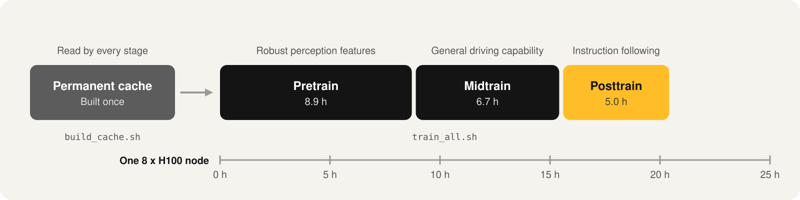
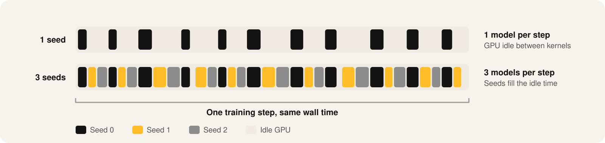
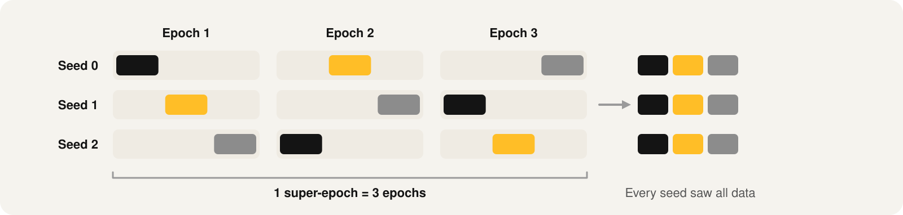
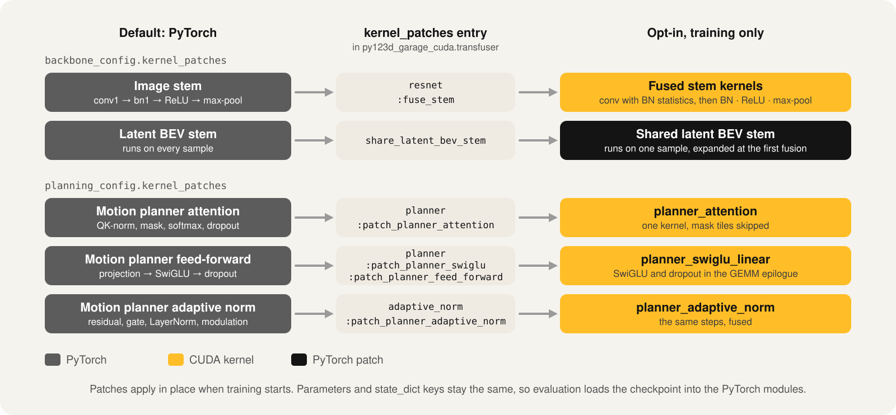
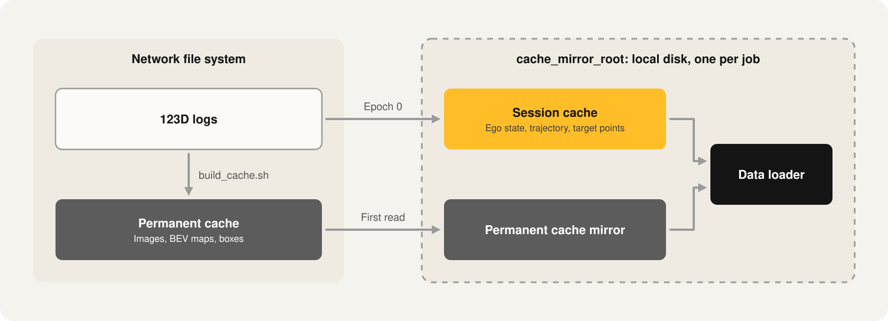

<div align="center">


</div>

<h1 align="center">Training</h1>

## Overview



First build the permanent cache. All three stages share it, so it only needs a rebuild after the policy inputs change (see [Caching system](#caching-system)).

```bash
scripts/cache/build_cache.sh
```

Then train the three stages in one session:

```bash
# Either on all data
scripts/training/train_all.sh

# Or on nuPlan only
scripts/training/train_nuplan.sh
```

The table below gives the training times on all data, measured on one 8 x H100 node with the CUDA kernels enabled. Each stage starts with 20 to 40 minutes of data staging, kernel check and compilation before its first step; the times include them.

| Stage     |  Epochs | Super-epochs | Per epoch | Time on 8 x H100 |
| :-------- | ------: | -----------: | --------: | ---------------: |
| Pretrain  |      93 |           31 |   5.2 min |            8.9 h |
| Midtrain  |      45 |           15 |   8.4 min |            6.7 h |
| Posttrain |      45 |           15 |   5.9 min |            5.0 h |
| **Total** | **183** |       **61** |           |       **20.6 h** |

## Accelerate small-scale experiments with multi-seed training

Closed-loop scores vary from seed to seed, so we train three and report their mean. A single TransFuser leaves most of a modern GPU idle, so the three seeds train together in one job and share one data loader, at little more than the cost of one.



Each seed still trains as it would alone. The loader loads three times the batch and hands every seed its own third, a stage runs three times the epochs, and the cosine warm-restart schedule and the checkpoint interval stretch by the same factor. Three epochs make a super-epoch: the thirds rotate within it, so every seed sees every sample once and no two seeds see the same sample in the same step. Seed *i* of a stage continues from seed *i* of the stage before.



To train one seed only, pass `num_seeds=1` and a third of the epochs, `lightning_trainer_config.max_epochs=31` for the pretrain and `15` for the two later stages. The batch, the schedule and the checkpoint interval follow the seed count by themselves, and the next stage takes the single weights file in `initial_weights_files`.

As a side note, we occasionally observe one seed diverging during training, which then scores noticeably below the other two in closed loop.

## Modify, compile and use custom CUDA kernels



Optional CUDA kernels replace parts of the encoders, the heads and the motion planner. They mirror the PyTorch code and are used in training only, so evaluation and checkpoints never depend on them. They need an Ampere or newer GPU, the fastest ones Hopper. Each kernel is a fast path: where the GPU, the shapes or another kernel rule it out, that call runs PyTorch and the kernel report says why; `kernel_check_require_patches=true` stops the run instead. Before the first step of every stage, a check compares several batches with and without the kernels and stops the run only when they change the loss or a module's gradients beyond bf16 rounding. On H100, with every kernel, they shorten the training step by about 17 % in pretraining and by about 30 to 35 % in midtraining and posttraining:

| Stage     | Step time saved with CUDA kernels | MFU with PyTorch | MFU with CUDA kernels |
| :-------- | --------------------------------: | ---------------: | --------------------: |
| Pretrain  |                             ~17 % |            ~19 % |                 ~23 % |
| Midtrain  |                             ~35 % |            ~15 % |                 ~23 % |
| Posttrain |                             ~29 % |            ~12 % |                 ~17 % |

Build them once against the installed PyTorch, and again after every change of the kernels:

```bash
# Install CUDA-toolkits once
conda install -c conda-forge cuda-nvcc=12.8 cuda-cudart-dev=12.8 cuda-cccl=12.8 cuda-driver-dev=12.8 libcublas-dev libcusparse-dev libcusolver-dev libcurand-dev cuda-version=12.8 gcc_linux-64=13 gxx_linux-64=13 ninja

# Compile kernels
TORCH_CUDA_ARCH_LIST=9.0 CUDA_INC_PATH="$CONDA_PREFIX/targets/x86_64-linux/include" pip install --no-build-isolation ./cuda
```

Then enable them in the training script.

## Caching system



The permanent cache holds images, BEV maps and boxes. It is built once, on one machine or as a Slurm array, and all stages share it. Rebuild it after changing the policy inputs.

The session cache holds ego state, trajectory labels and target points. These depend on the stage, so every stage builds its own from the 123D logs: while the stage before it trains, or else during its first epoch.

Both live on a fast local disk when the training script names one; we use each job's SSD. Each log of the permanent cache is copied there on its first read, which avoids random reads over the network file system, and the three stages share that copy. Without a local disk there is no session cache.
